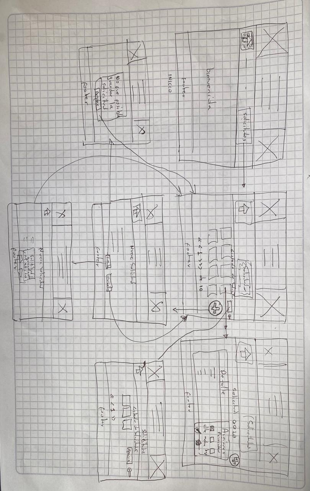

# PRODUCTO

Una organización brinda apoyo a líderes comunitarios para mejorar la calidad de vida y convivencia en sus comunidades.  Recibe solicitudes para jornadas de limpieza, apoyo escolar, recuperación de espacios, donaciones y acompañamiento a personas mayores. El problema principal es que en este momento no cuentan con una plataforma que les permita gestionar eficientemente estas solicitudes y coordinar a los voluntarios, por tanto no es posible hacer seguimiento de las actividades ni medir el impacto de las acciones realizadas.

## Usuario principal y decisión que necesita tomar

Coordinador de la operación(Valeria) Decide qué atender sin revisar múltiples canales. Ve el panorama, busca solicitudes, abre detalle, marca prioridad y registra nuevos casos.

## Funciones imprescindibles del MVP
1. Registrar lideres comunitarios.
2. Registrar solicitudes de apoyo por parte del líder.
3. Listar y filtrar solicitudes de apoyo.
4. Registrar Aliado o Evaluador de la organización.
5. Generar un dashboard con métricas de impacto y seguimiento de solicitudes.

## Elementos explícitamente fuera de alcance
1. Gestión de seguridad y autenticación de usuarios.
2. Modificación del backend.
3. Persistencia de datos en base de datos.

**Nota:** El backend y la autenticación no hacen parte del alcance del MVP, debido a que se van a poner en práctica los conocimienntos vistos en el primer módulo.

## Riesgo principal de usar una API simulada
El riesgo principal de usar un API simulada es que en cualquier momento puede dejar de funcionar, lo que afectaría la capacidad de la aplicación para interactuar con los datos reales y podría generar inconsistencias en la información mostrada a los usuarios.

## Definición personal de terminado
La aplicación es funcional respetando el alcance definido y MVP y dando cumplimiento a las historias de usuario involucradas en el alcance.

## Flujo MVP

